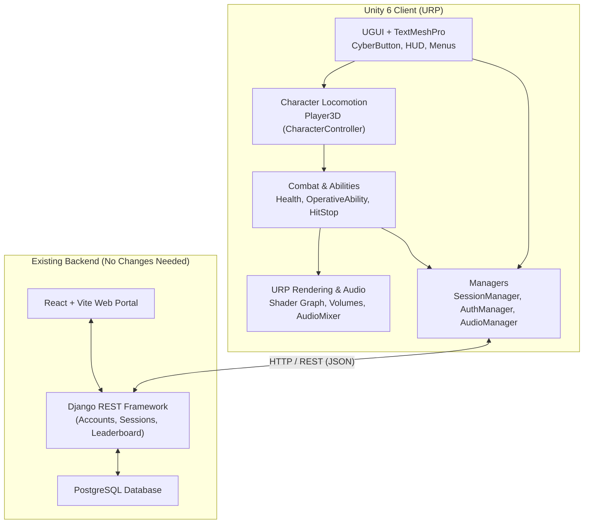
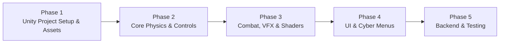

# Axiom Force: Unity Migration Plan & Feasibility Analysis

> [!NOTE]
> **Executive Summary & Feasibility Verdict**:
> **Feasibility is HIGH (Estimated 65–70% direct C# logic reuse).**
> Because Axiom Force is already written in modern C# (.NET) with a decoupled, component-based architecture and a RESTful Django backend, migrating to Unity does not require rewriting core game logic or backend infrastructure. The primary engineering tasks involve translating Godot node hierarchies and physics/rendering APIs to Unity `MonoBehaviour`, Universal Render Pipeline (URP), UGUI/TextMeshPro, and Unity's New Input System.

---

## 1. Architectural Mapping: Godot 4.7.2 .NET vs. Unity 6 / 2022+ (URP)

| Domain | Godot 4.7.2 (.NET C#) | Unity Universal Render Pipeline (URP C#) | Migration Complexity |
| :--- | :--- | :--- | :--- |
| **Object Hierarchy** | `Node`, `Node3D`, `Control` | `GameObject` + `MonoBehaviour` | Low (Direct 1:1 mapping) |
| **Lifecycle Hooks** | `_Ready()`, `_Process()`, `_PhysicsProcess()` | `Awake()`, `Start()`, `Update()`, `FixedUpdate()` | Low (Trivial rename/reorder) |
| **Signals & Events** | `[Signal] public delegate void EventName()` | `public event Action<...>` or `UnityEvent` | Low (Standard C# delegates) |
| **Character Physics** | `CharacterBody3D` + `MoveAndSlide()` | `CharacterController` (`Move()`) or `Rigidbody` | Medium (Tuning step-height/slope) |
| **Collision Queries** | `Area3D`, `PhysicsDirectSpaceState3D.IntersectShape` | `Collider` (`isTrigger = true`), `Physics.OverlapSphereNonAlloc` | Low (Exact mathematical equivalents) |
| **Vectors & Math** | `Godot.Vector3`, `Basis`, `Quaternion` | `UnityEngine.Vector3`, `Matrix4x4`, `Quaternion` | Low (Syntax swap, LHS coordinates) |
| **Camera & 3D Math** | `Camera3D.GlobalTransform.Basis` | `Camera.main.transform` forward/right | Low (Coordinate system: Godot Y-up/Z-back vs Unity Y-up/Z-forward) |
| **Spatial Shaders** | `holographic.gdshader`, `cyber_scanlines.gdshader` | URP Shader Graph / HLSL Surface Subsurface Shaders | Medium (Node-by-node Shader Graph recreation) |
| **Post-Processing** | `WorldEnvironment` (Glow, ACES Tonemap) | URP Volume (`Bloom`, `Tonemapping ACES`, `Vignette`) | Low (Unity URP Volumes provide richer control) |
| **UI System** | 2D `Control`, `NinePatchRect`, `SubViewport` | `Canvas` (UGUI), `Image` (Sliced 9-slice), `TextMeshProUGUI` | Medium (UGUI is mature and robust) |
| **3D Menus** | `SubViewport` + `SubViewportContainer` | `RenderTexture` with Camera OR Screen-Space Camera Canvas | Low (Easier in Unity via Multi-Camera or RenderTextures) |
| **Tweening / VFX** | `CreateTween()`, `TweenProperty()` | `DOTween` (or Unity Coroutines) | Low (Syntactically similar fluent APIs) |
| **Audio** | `AudioStreamPlayer3D`, `AudioServer` buses | `AudioSource`, `AudioMixer` with Neon SFX Snapshots | Low (Direct MP3 asset import) |
| **Backend & Web** | Django REST API (HTTP Client, JSON) | Same (`HttpClient` or `UnityWebRequest`, `System.Text.Json`) | Negligible (Backend & Web require 0 changes) |

---

## 2. Deep-Dive Component Conversion Strategies

### 2.1 Character Locomotion (`Player3D.cs`)
- **Godot Implementation**: Uses `CharacterBody3D`, `Input.GetVector("move_left", "move_right", "move_forward", "move_backward")`, camera-basis projections, and `MoveAndSlide()`.
- **Unity Port**:
  - Replace `CharacterBody3D` with Unity's standard `CharacterController`.
  - Use Unity New Input System (`InputActionAsset`) generating a C# wrapper for `WASD`, `Jump`, `Ability1`, `Ability2`, `Pause`.
  - Coordinate system conversion: In Godot, Z is backwards (`+Z` toward viewer, `-Z` forward). In Unity, Z is forward (`+Z` away from viewer). Camera-relative movement calculation:
    ```csharp
    // Unity C# equivalent for camera-relative locomotion
    Vector3 forward = Camera.main.transform.forward;
    Vector3 right = Camera.main.transform.right;
    forward.y = 0f; right.y = 0f;
    forward.Normalize(); right.Normalize();

    Vector3 wishDir = (forward * inputVector.y + right * inputVector.x).normalized;
    velocity.x = wishDir.x * MoveSpeed;
    velocity.z = wishDir.z * MoveSpeed;
    
    // Gravity and jumping
    if (controller.isGrounded) {
        if (jumpPressed) velocity.y = JumpVelocity;
        else velocity.y = -0.5f; // Small ground snapping
    } else {
        velocity.y -= Gravity * Time.deltaTime;
    }
    controller.Move(velocity * Time.deltaTime);
    ```

### 2.2 Health, Damage & Combat System (`Health.cs`, `OperativeAbility.cs`)
- **Godot Implementation**: Signals `[Signal] delegate void HealthChangedEventHandler(int current, int max)` and `[Signal] delegate void DiedEventHandler()`. Physics queries via `GetWorld3D().DirectSpaceState.IntersectShape()`.
- **Unity Port**:
  - Convert signals to standard C# events: `public event Action<int, int> OnHealthChanged;` and `public event Action OnDied;`.
  - `OperativeAbility`: Convert Godot physics shapes to Unity non-allocating sphere/box casts:
    ```csharp
    Collider[] hitColliders = new Collider[16];
    int count = Physics.OverlapSphereNonAlloc(transform.position, AbilityRadius, hitColliders, TargetLayerMask);
    for (int i = 0; i < count; i++) {
        if (hitColliders[i].TryGetComponent<Health>(out var targetHealth)) {
            targetHealth.TakeDamage(DamageAmount, DamageType);
        }
    }
    ```

### 2.3 Visual Effects & Shaders
- **Holographic Shader (`holographic.gdshader`)**:
  - Replaced by a **URP Shader Graph**:
    - **Fresnel Effect Node** connected to Emission Color with HDR multiplier.
    - **Tiling And Offset Node** (UV.y + `Time * ScanSpeed`) feeding into a `Sine` or `Fraction` node for cyber scanlines.
    - **Noise Node** (Simple Noise) multiplied by Time for glitch flicker and alpha cutouts.
- **Cyber Scanlines Post-Process (`cyber_scanlines.gdshader`)**:
  - Replaced by a custom URP **Scriptable Render Feature** (Full Screen Pass Renderer Feature) with a Blit material.
- **Neon Pulse Sync (`NeonPulseManager.cs`)**:
  - Material instances in Unity are modulated via `material.SetColor("_EmissionColor", pulseColor * intensity)`.
  - Can use `DOTween` or a single synchronized manager updating a global shader vector: `Shader.SetGlobalColor("_NeonPulseColor", ...)`.

### 2.4 Cyber UI & "Command Center" 3D Menu
- **CyberButton (`CyberButton.cs`)**:
  - Godot uses custom 9-patch border drawing and tween-based hover scaling.
  - Unity equivalent: Standard UGUI `Button` with `Image` (Image Type: Sliced) using custom 9-sliced cyber border sprite sprites, plus `EventTrigger` or `IPointerEnterHandler` / `IPointerExitHandler` triggering smooth hover scale with `DOTween` or Animator.
- **Command Center 3D Menu Background & Cinematic Environment**:
  - In Godot, [`ThreeDMenuExperience.cs`](file:///D:/Projects/frog_jumper/scripts/main_menu/ThreeDMenuExperience.cs) and [`3d_menu_experience.tscn`](file:///D:/Projects/frog_jumper/scenes/main_menu/3d_menu_experience.tscn) dynamically compose the "Axiom Force HQ Citadel" using 19 GLB models and a distant backdrop quad rendered through a `SubViewport`.
  - **Unity Recreation Workflow**:
    1. **Pre-Authored 3D Scene (`AxiomHQ_Menu.unity`)**: Instead of programmatically loading GLBs at runtime via code, import all 19 `.glb` models into `Assets/Art/Models/HQ/` and assemble the scene visually in Unity with Prefabs:
       - **Centerpiece Citadel**: `Meshy_AI_Axiom_Force_HQ_Buildi.glb` scaled to `(17, 17, 17)` at `(0, 6.2, -2)`.
       - **Architectural Skyline**: Bio-Gen Corporate Spire, Neuro-Link Tower, Syndicate Hab-Block, Aegis Defense Bastion, Elevated Sky-Highway, and Monorail Gantry.
       - **Plaza Complex**: Metallic Floor Grid `(14, 1, 14)`, Gunship Landing Pad, Holo-Projector Pedestal, Terminal Kiosk Node, Armored Perimeter Barriers, and Automated Defense Turrets.
       - **Distant Skyline Backdrop**: Unlit Quad `(160x90)` using `Gemini_Generated_Image_t8s2p4t8s2p4t8s2.png` at `Z = -40`.
    2. **Living City Ambient Traffic & Hover Mechanics**:
       - Create lightweight `AmbientHover.cs` and `AmbientPatrol.cs` components:
         - **VTOL Gunship**: Organic vertical hover sway (`hoverY = baseHeight + sin(Time.time * 2.2f) * 0.35f`) on the landing pad.
         - **Police Spinner**: Patrols lower sky-highway lane (`X: -65 to +65`) with gentle sine wave vertical bobbing.
         - **Cargo Barge**: Moves along upper freight lane in reverse direction.
         - **Holo Shield Emblem**: Continuous smooth rotational oscillation above the citadel.
    3. **Cinematic Camera Transition (Cinemachine)**:
       - Setup two Cinemachine Virtual Cameras:
         - `vcam_HighView`: Position `(0, 10, 26)`, Rotation `(-6, 0, 0)` overlooking the city canyon.
         - `vcam_PlazaView`: Position `(0, 3.8, 15)`, Rotation `(2, 0, 0)` framing the entrance terminal.
       - When the user presses any key from the title screen, trigger a Cinemachine blend over 2.0s with a Cubic ease-in-out curve.
    4. **Lighting & Post-Processing (URP Volume)**:
       - Directional light (moon/ambient city wash) in cool blue `(0.85, 0.92, 1.0)`.
       - Dual accent point lights: Cyan (`#00e6ff`) and Neon Pink/Magenta (`#ff007f`) with URP Bloom.
       - Screen Space Ambient Occlusion (SSAO) and ACES Tonemapping for photorealistic cyberpunk contrast.

### 2.5 Backend, Authentication & Sessions
- **Django REST Backend**: Completely engine-agnostic.
  - Endpoints: `POST /api/auth/login/`, `POST /api/auth/register/`, `GET/POST /api/sessions/`, `GET /api/leaderboard/`.
  - Unity uses C# `System.Net.Http.HttpClient` or `UnityEngine.Networking.UnityWebRequest`. The existing JSON DTO models (`AuthResponse`, `SessionData`, `UserProfile`) can be copied directly with zero modifications.

---

## 3. High-Level Migration Architecture



---

## 4. Phase-by-Phase Execution Roadmap



### Phase 1: Project Setup, Tooling & Asset Ingestion
- Starter Unity project is located at: `D:\Projects\frog_jumper\Axiom Force` (Unity 6 / 6000.6.3f1 with URP).
- Core packages already verified:
  - `com.unity.render-pipelines.universal` (17.6.0)
  - `com.unity.inputsystem` (1.20.0)
  - `com.unity.ugui` (2.6.0)
  - `com.unity.ai.navigation` (2.0.14)
  - `com.unity.test-framework` (1.8.0)
- Asset Ingestion Plan:
  - **Models**: Copy 19 `.glb` models from `assets/models/hq/` to `Axiom Force/Assets/Art/Models/HQ/`.
  - **Audio**: Copy 160 `.mp3` files from `assets/audio/` to `Axiom Force/Assets/Audio/`.
  - **Fonts**: Copy 17 `.ttf` fonts from `assets/fonts/` to `Axiom Force/Assets/Fonts/` and generate TextMeshPro SDF font assets.
  - **Backdrop & 2D Logos**: Copy localized title banners and skyline backdrop images.

### Phase 2: Core Gameplay & Physics Locomotion
- Port `Player3D.cs` to Unity `CharacterController`.
- Port `Enemy3D.cs`, `TimedTrap.cs`, `DestructibleCover.cs`, `ExplosiveBarrel.cs`, and `FinishZone3D.cs`.
- Setup Unity collision layers & matrix: `Player`, `Enemy`, `Hazards`, `Environment`, `Projectiles`.

### Phase 3: Combat, Operative Abilities, Shaders & VFX
- Port `Health.cs` and `OperativeAbility.cs` with event-driven damage hooks.
- Create URP Shader Graphs:
  - `SG_Holographic` (Fresnel + scanlines + glitch).
  - `SG_NeonPulse` (Global synchronized emission).
  - `SG_CooldownRing` and `SG_FloatingHealthBar`.
- Port `CombatVFXManager.cs` (hit-stop freeze frame via `Time.timeScale`, screen shake, damage number popups).
- Setup `AudioMixer` with snapshots for combat ducking, neon pulse reverb, and UI clicks.

### Phase 4: UI System & 3D Command Center
- Create CyberButton prefab using sliced neon sprites, text styling, and hover/click audio.
- Recreate `PlayerHUD3D` (Segmented health bars, cooldown meters, score counters).
- Recreate Main Menu & 3D Command Center environment (`AxiomHQ_Menu.unity`):
  - Stage the 3D terminal kiosk, holographic projector, and operative showcase.
  - Render terminal UI using Canvas in Screen-Space Overlay or World-Space on kiosk monitor.

### Phase 5: Backend Integration, Persistence & Unit Testing
- Copy `AuthManager.cs` and `SessionManager.cs` into Unity scripts.
- Port NUnit test cases into Unity Test Framework (`EditMode` and `PlayMode`).
- Connect to live/local Django REST server and verify registration, login, session sync, and leaderboard submission.

---

## 5. Verification & Testing Plan

### Automated Verification
1. **Unity Test Framework (UTF)**:
   - Port all existing NUnit tests from `tests/AxiomForce.Tests/` to Unity EditMode tests.
   - Verify `SessionManagerTests`, `HealthTests`, `ScoreCalculatorTests`, `OperativeAbilityTests` pass with 100% green status.
2. **Backend Regression Testing**:
   - Run `python backend/manage.py test accounts` to confirm API contracts remain intact.
3. **Godot Regression Testing**:
   - Run `.\run_tests.ps1` to ensure the original Godot engine version remains 100% operational during the migration.

### Manual QA Scenarios
1. **Locomotion & Camera**:
   - WASD movement is responsive with identical acceleration and deceleration to Godot.
   - Jumping over obstacles adheres to expected gravity arc and ledge tolerances.
2. **Combat & Abilities**:
   - Melee strike, AoE pulse, Push, and Dash trigger correct collision sweeps and apply damage to target health components.
   - Hit-stop briefly pauses simulation without desyncing audio or camera animation.
3. **Cyber Command Center UI**:
   - Hovering over buttons produces neon glow, tilt/scale, and UI chime.
   - Switching operative rotates the 3D hologram model smoothly.
4. **Backend Sync**:
   - Guest session offline fallback works if backend is offline.
   - Online authentication logs in, stores token in `PlayerPrefs` / secure storage, and posts session score to Django leaderboard.
