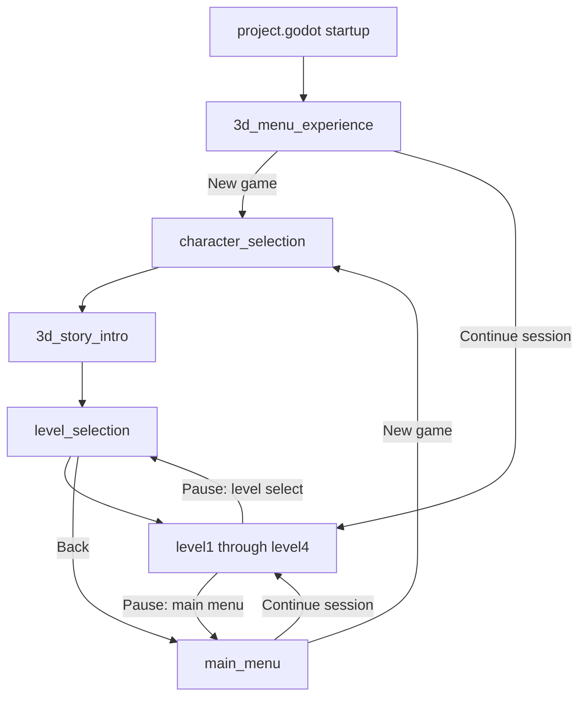

# Axiom Force — Technical Audit #03

**Target:** Godot **4.7.2 .NET**, as confirmed by the project owner.  
**Audit date:** 2026-09-15. **Baseline commit:** `b5bcdef81333f0b09944c7a5b599994dc60ff2d8`.  
**Workspace:** `D:\Projects\frog_jumper`; the project is named Axiom Force, but the physical directory still has its old name.

## Executive finding

This is already a mixed Axiom Force prototype: a substantial cyberpunk menu and asset library sit above a legacy 2D platformer. Preserve the presentation, material pipeline, input concepts, and basic movement. Rebuild the connections between character selection, gameplay, progression, saves, and application state before expanding the campaign.

The audit covers **all 35 scripts under `scripts/` (22 C#, 13 GDScript), one additional gameplay shader, all 21 scenes, and 434 source/support files under `assets/`**. Import metadata and generated translations are counted separately. Verdicts concern reuse; they do not certify every feature as production-ready.

## 1. [KEEP]

- **Global state foundation:** `scripts/managers/GameManager.gd` has the requested five states, player metadata, validated setter, duplicate suppression, and `state_changed` signal. Keep it and connect real transitions to it.
- **Platformer fundamentals:** gravity, horizontal movement, jumping, `MoveAndSlide`, sprite direction, collision areas, and camera follow are reusable for a 2D Shogun. Keep these algorithms while consolidating the duplicated controllers.
- **Cyber presentation:** retain the 3D headquarters, camera transition concept, six operative previews, AXIOM-7 companion, localized branding, typography, cyber backgrounds, and reusable UI visuals.
- **Small reusable components:** `FloatingRobotBuddy3D.cs`, `SegmentedStatBar.cs`, `CyberCircularSpinner.cs`, and the live GDScript loading bridge. Their dependencies and limited polish needs are described below.
- **Import/rendering foundation:** `NeonMaterialImport.gd`, `cyber_glow.tres`, and the PBR model library. ACES, additive glow, and lit/specular materials are already configured.
- **Useful implementation patterns:** input-device signals, custom UI signals, animation-completion callbacks, threaded scene loading, localized data lookup, and procedural UI sound generation. Preserve these patterns within the refactors below.

## 2. [REFACTOR]

- **Player architecture and combat:** consolidate `BaseCharacter`, `MainCharacter`, `CyberShogun`, and character spawning. All four campaign levels currently instantiate `main_character.tscn`; the dedicated Shogun scene is not wired into them. Add actual combat hit detection, damage, health, and enemy behavior when implementing combat.
- **Game flow and progression:** give one system ownership of scene changes, pause/death/completion, player selection, and level IDs. The new GameManager currently has no production callers. Fix finish/save contracts before depending on campaign progression.
- **Session persistence:** preserve the CRUD interface but replace synchronous client-side database access and unsynchronized JSON fallback with an explicit storage design and reliable save results.
- **Menus and previews:** split the approximately 1,800-line `MainMenu.cs`, separate 3D presentation from settings/auth/session UI, and replace hardcoded roster/layout data with shared definitions. Connect the six selectable operatives to valid gameplay representations.
- **Story and localization:** merge the two story controllers, connect `NarrativeManager`, centralize locale/voice/logo mapping, and choose one route through briefing, training, and level selection.
- **Settings, authentication, loading, and UI interaction:** keep their useful behavior while fixing the specific gaps in section 4. These are existing Axiom Force systems; changing the theme alone will not resolve their integration defects.

## 3. [TRASH]

These are removal recommendations, not deletions performed by this audit.

| Candidate | Reason | Dependency condition before removal |
|---|---|---|
| `FallingCharacter.cs`, `FallingTurtle.cs`, and `falling_character.tscn` | Legacy falling-character menu decoration; `FallingTurtle` adds only a default identity. | Remove `MainMenu`'s cached scene, spawn timer, and spawn method first. Its active 3D subclass still inherits the initialization code. |
| Cloud/spawn branches inside `MainMenu.cs` | Legacy decorative system mixed into an otherwise reusable menu. | Remove corresponding texture/scene references and runtime initialization together. Preserve settings/session/auth functions. |
| `GameHome.cs` and `game_home.tscn` | Unreferenced alternate splash, superseded by the active 3D home/menu flow. | No incoming reference was found in project settings, production scripts, or scenes. Retire the pair together after confirming it is not an intended alternate entry point. |
| `training_protocol.gd` | Only `extends Node` and comments; implements no training behavior and is not attached to the training scene. | Can retire this empty script; decide separately whether to implement the existing training scene. |
| Old fruit/end-marker/platformer art and old character-name branches | Frog Jumper presentation does not meet the new art direction. Some old character sprite paths now point to absent files. | Replace the pickup/finish/level/player visuals first. `Cherries.png`, `End (Idle).png`, and legacy level art still have live scene dependencies. |
| Stale helpers/comments and duplicate screens after consolidation | Unused sprite-slicing helpers and Unity/Ink migration comments misdescribe current behavior. | Remove after caller checks. `StoryIntro` has reusable locale/audio logic; extract it before retiring its alternate scene. |

**Do not delete whole asset directories or all old menu code.** The current levels and return routes still use them. An asset lacking a literal path reference may still be loaded through a constructed path or an imported material.

## 4. Important implementation findings

### 4.1 The selectable roster is ahead of gameplay

Every campaign scene contains a node named `CyberShogun`, but that node instances **`main_character.tscn`**, whose controller is **`MainCharacter.cs`**. The dedicated `cyber_shogun.tscn` is referenced by `character_spawner.gd`, which is not attached to any of the 21 scenes.

`MainCharacter`'s Shogun branch creates locomotion animations from one sprite sheet but creates **no sword/karate animations**. Its attack input requires those animations, so the current campaign Shogun cannot enter those attacks. `CyberShogun.cs` does contain animation-based attack behavior, but neither controller implements damage, hitboxes, health, or enemy AI. The GLB run/walk/slash assets are not connected to campaign gameplay.

The five other selectable heroes use 3D previews, while `MainCharacter` tries to load old-style `Idle (32x32).png`, `Run (32x32).png`, etc. Those required sprite sets are absent for the modern roster. Preview speed/agility values are presentation data, not gameplay stats.

Evidence: [level1.tscn](../scenes/gameplay/level1.tscn) lines 6/369; equivalent instances in levels 2–4; [MainCharacter.cs](../scripts/actors/MainCharacter.cs) lines 80–119 and 165 onward; [character_spawner.gd](../scripts/actors/character_spawner.gd); [CharacterSelection.cs](../scripts/main_menu/CharacterSelection.cs) lines 168–227/502–513.

### 4.2 Level completion and saves have concrete contract errors

- `finish.gd` accesses `SessionManager.current_session_id` and `game_manager.points`, but the C# properties are **`CurrentSessionId`** and **`Points`**. Existing generated assembly metadata confirms PascalCase properties and no matching lowercase aliases. Snake_case aliases exist for methods only. The first property access can interrupt completion before its timer/scene change.
- Every finish instance retains the exported default `current_level_number = 1`; no level overrides it. `SaveScore` also tries to parse the current scene's name, but all four campaign roots are named `Node`. These paths therefore cannot identify levels 2–4 correctly.
- Completion attempts to write score/progress through two different paths. Session updates replace `total_score` with the current level's points, so previous level scores are not accumulated. Repairing only the property spelling would leave duplicate writes and unclear score semantics. Collectable totals are passed as zero.
- `Global.unlocked_levels` is an in-memory field, separate from saved-session level progress. Loading a session does not restore a consistent unlock model.
- Pickups remain active during their 0.2-second sound delay. Repeated eligible entries can start multiple award callbacks. Finish areas also lack a one-shot completion guard.

Evidence: [finish.gd](../scripts/gameplay/finish.gd) lines 4/25–43; [gameplay/GameManager.cs](../scripts/gameplay/GameManager.cs) lines 24/51–63; [SessionManager.cs](../scripts/managers/SessionManager.cs) lines 46/251 onward; [collectable.gd](../scripts/gameplay/collectable.gd); [global.gd](../scripts/managers/global.gd) lines 9/414.

### 4.3 The persistent state manager is present but unused

No production script calls `set_game_state`, subscribes to `state_changed`, or updates the new player's username/level fields. Consequently, its state remains `MAIN_MENU` throughout the existing flow unless an external caller changes it. Pause uses the scene tree directly; gameplay uses `Global.reached_finish`; account and save state live in separate managers.

Also distinguish **`scripts/managers/GameManager.gd`** (persistent application state) from **`scripts/gameplay/GameManager.cs`** (scene-local score/HUD/water restart). Rename the latter to something like `LevelController` during consolidation to clarify ownership.

### 4.4 Saves and account integration need repair

`SessionManager` uses synchronous PostgreSQL operations on the game thread with a compiled local connection configuration. Its JSON fallback is a separate store: no synchronization, stable shared identity, or recovery policy connects the two. Database rows have no account owner. JSON writes replace the file directly; a parse failure becomes an empty list, and save errors are not reliably returned to callers.

The included authentication client and Django backend disagree on specific contracts:

- Profile startup fetch requests `/api/profile/`; the included backend mounts `/api/auth/profile/`.
- Login/browser profile decoding uses case-sensitive defaults against lowercase `id`, `username`, and `email` fields, while the C# DTO uses PascalCase.
- Native login expects tokens immediately, but the backend can return a `2fa_required` challenge.
- A refresh token is stored but never refreshed; token storage uses an unencrypted ConfigFile. Browser polling exists in the service but has no production game caller.

These are local source findings, not results of testing a deployed service. Configure the endpoint, match response contracts, define account ownership, and make save failures recoverable before relying on online progression.

Evidence: [SessionManager.cs](../scripts/managers/SessionManager.cs) lines 29/73/85/251/424/534/557; [AuthManager.cs](../scripts/managers/AuthManager.cs) lines 121/125/194/248/274; [backend routes](../backend/accounts/urls.py); [backend serializers](../backend/accounts/serializers.py); [backend views](../backend/accounts/views.py).

### 4.5 Story, training, and settings are disconnected

- The active route is selection → **3D story → level selection**. Only the alternate `StoryIntro.cs` routes to training, and no production entry to that alternate story scene was found. The training scene has no training controller or completion sequence.
- Both story controllers hardcode four translated text entries. Neither consumes `NarrativeManager`'s JSON data. That manager is a JSON reader, **not an Ink runtime**, despite repository comments/documentation.
- Language changes do not reload narrative data. Settings use raw language names; the 3D story uses the locale directly as a voice folder. For example, `eurofrench` does not match the `french` audio folder, so it falls back to English. A single locale-to-asset map would fix this mismatch.
- Startup forces English/fullscreen; the settings loader restores only keybindings. Restoring keyboard bindings erases all action events, including gamepad bindings, before adding keys.
- Four Global audio-control methods are empty `pass` stubs, so menu music calls do nothing.

Evidence: [ThreeDStoryIntro.cs](../scripts/main_menu/ThreeDStoryIntro.cs) lines 73/156/269; [StoryIntro.cs](../scripts/main_menu/StoryIntro.cs) lines 226/348; [NarrativeManager.gd](../scripts/managers/NarrativeManager.gd); [audio_options.gd](../scripts/ui/audio_options.gd) lines 115–127; [global.gd](../scripts/managers/global.gd) lines 25/35/333/352/400–410.

### 4.6 Keep the visual systems, fix their lifecycle and loading boundaries

- `ThreeDMenuExperience` inherits the full `MainMenu` and calls its `_Ready`, creating legacy clouds, but overrides `_Process` without running the cloud/spawn update. Separate the old decoration from the new 3D presentation.
- HQ model creation is synchronous inside `_Ready`. Character selection loads all six previews and the platform on its first selection, despite a comment describing lazy loading. A threaded scene loader does not automatically make these later runtime model loads asynchronous.
- Both loading entry points delete the outgoing scene before the requested scene succeeds. Failure displays an error but offers no retry/back route. Preserve the threaded loader while adding transition recovery.
- `CyberDropdown` has a mouse opener but incomplete keyboard/gamepad and dismiss behavior. `CyberButton` click sound plays internally and again through `UISoundManager` wiring.
- `MainMenu` subscribes to a persistent C# profile event without unsubscribing on scene exit. Several branding loaders use OS file APIs on `res://` paths and need packaged-build checks.
- `main_menu.tscn` still declares two signal connections from missing language-button/popup nodes (lines 813/817). Resolve these stale connections when consolidating the return menu.
- Pause/resume works through the scene tree, but its screen-copy overlay remains active when the menu panel is hidden. The blur shader uses LOD 0 and its animation does not increase it, so the current pause blur is a placeholder. Player B-button sword input also overlaps `ui_cancel`, which the pause controller handles.

Evidence: [ThreeDMenuExperience.cs](../scripts/main_menu/ThreeDMenuExperience.cs) lines 62/101/235; [CharacterSelection.cs](../scripts/main_menu/CharacterSelection.cs) lines 230–334; [LoadingScreen.cs](../scripts/ui/LoadingScreen.cs) lines 105–178; [CyberDropdown.cs](../scripts/ui/CyberDropdown.cs) line 102; [UISoundManager.cs](../scripts/managers/UISoundManager.cs) line 149; [MainMenu.cs](../scripts/main_menu/MainMenu.cs) lines 142/1791.

## 5. Complete script inventory

Paths in each table are relative to its heading. **KEEP** means retain the implementation with ordinary integration/polish; **REFACTOR** means retain useful behavior while changing its structure/contracts; **TRASH** means retire under the conditions in section 3.

### `scripts/actors/` — 7 scripts

| Script | Language | Current purpose | Verdict |
|---|---|---|---|
| `BaseCharacter.cs` | C# | Shared CharacterBody2D movement, gravity, jump sound, sprite switching, movement stop, and special-action hook. Used by CyberShogun; contains extensive debug output/timer. | **REFACTOR:** keep movement core; unify with MainCharacter, export tuning, separate animation/combat. |
| `MainCharacter.cs` | C# | Actual campaign player; creates SpriteFrames, handles keyboard/gamepad movement and conditional attack animations. | **REFACTOR:** central live controller; repair roster/animation contracts and remove duplicate movement implementation. |
| `CyberShogun.cs` | C# | BaseCharacter subclass with Shogun animation slicing and animation-only sword/karate actions. | **REFACTOR:** integrate a single player scene and implement combat; currently outside campaign wiring. |
| `character_spawner.gd` | GDScript | Chooses Shogun or generic player scene, positions it, and attaches a smoothed Camera2D. | **REFACTOR:** useful spawning seam, currently unattached; use a complete character definition map. |
| `FloatingRobotBuddy3D.cs` | C# | AXIOM-7 GLB loading, material emission pulse, hover/rotation, and thruster particles. Created by both story controllers. | **KEEP:** reusable cyber companion/presentation component; consolidate asset loading with other GLB users. |
| `FallingCharacter.cs` | C# | Builds decorative character animations and drops them down the menu background. | **TRASH:** remove with MainMenu's legacy spawn system. |
| `FallingTurtle.cs` | C# | FallingCharacter subclass that only chooses the Shogun identity. | **TRASH:** redundant legacy decoration subclass. |

### `scripts/gameplay/` — 5 scripts plus shader

| Script | Language | Current purpose | Verdict |
|---|---|---|---|
| `GameManager.cs` | C# | Per-level points label, point increments, save forwarding, and water-triggered deferred restart. | **REFACTOR:** retain level-event/HUD concepts; rename and repair save/level identity contracts. |
| `collectable.gd` | GDScript | Area2D body entry plays a sound, waits, removes the pickup, and awards a point. | **REFACTOR:** reuse pickup pattern for energy/data; guard collection once and avoid direct score-manager coupling. |
| `finish.gd` | GDScript | Stops player/music, plays finish sound, unlocks/saves, waits, and loads target scene. | **REFACTOR:** fix property names, IDs, duplicate persistence, and one-shot completion. |
| `pause_menu.gd` | GDScript | Escape/gamepad pause, blur animation, resume/restart/level-select/main-menu navigation. | **REFACTOR:** retain UI behavior; synchronize GameManager state and centralize scene/unpause handling. |
| `training_protocol.gd` | GDScript | Comment-only training placeholder; no functions and no scene attachment. | **TRASH:** remove empty script; implement training separately if retained. |
| `pause_menu.gdshader` | Godot shader language | Samples the screen at a configurable mip level; current scene/animation keep it at LOD 0. | **REFACTOR:** implement a visible pause-only blur/tint or remove the no-op screen-copy effect. |

### `scripts/main_menu/` — 9 scripts

| Script | Language | Current purpose | Verdict |
|---|---|---|---|
| `MainMenu.cs` | C# | New/continue/delete sessions, settings/key rebinding, localization, profile display, popup styling, cursor, and legacy background effects. | **REFACTOR:** split the monolith and remove decoration branches; still used directly and through inheritance. |
| `ThreeDMenuExperience.cs` | C# | Active menu subclass; constructs HQ from GLBs, animates vehicles, presents home overlay, and tweens camera into menu. | **REFACTOR:** retain presentation; separate menu logic and author model/layout data outside the controller. |
| `CharacterSelection.cs` | C# | Six operative previews, display stats, rotation, platform emission, session creation, and deployment to 3D story. | **REFACTOR:** data-driven roster, real gameplay mapping, recoverable session creation, selective model loading. |
| `ThreeDStoryIntro.cs` | C# | Active four-entry localized briefing, typewriter, voice playback, AXIOM-7, continue/skip, then level selection. | **REFACTOR:** connect narrative data and consistent locale/scene flow; share presentation behavior. |
| `StoryIntro.cs` | C# | Alternate briefing with runtime 3D companion viewport, broader voice-folder mapping, and transition to training. | **REFACTOR:** salvage shared dialogue/audio behavior, then retire duplicate scene/controller. No incoming production scene reference found. |
| `GameHome.cs` | C# | Alternate 2D logo/prompt splash with fade into `main_menu.tscn`. | **TRASH:** redundant, unreferenced entry scene; active project starts in 3D menu. |
| `LoginScene.cs` | C# | Standalone login/signup form, website button/connectivity check, and CSV language selector. | **REFACTOR:** align with repaired auth service and choose one reachable account entry flow; currently unreferenced by production navigation. |
| `leaderboard.gd` | GDScript | Renders operative/score rows from all stored sessions. | **REFACTOR:** useful results view, but no incoming navigation reference and no score ranking/account/season model. |
| `level_selection.gd` | GDScript | Four sector buttons gated by Global unlocks, reset finish flag, and load levels. | **REFACTOR:** data-driven level catalog and saved progression; fixed four-level gating today. |

### `scripts/managers/` — 6 scripts, all autoloaded

| Script | Language | Current purpose | Verdict |
|---|---|---|---|
| `GameManager.gd` | GDScript | Persistent typed state/metadata store and state_changed signal. | **KEEP:** connect production callers; define transition ownership. |
| `global.gd` | GDScript | Legacy shared flags/unlocks, translations/fonts, input-device detection/prompts, keybindings, display modes, and empty music APIs. | **REFACTOR:** split responsibilities and fix persistence/input restoration. |
| `SessionManager.cs` | C# | Session CRUD/cache, PostgreSQL access, JSON fallback, and GDScript method aliases. | **REFACTOR:** storage integrity, account ownership, asynchronous boundary, and error contracts. |
| `NarrativeManager.gd` | GDScript | Localized JSON narrative loader/getters and reload API. | **REFACTOR:** keep data API; integrate story/locale consumers and schema validation. |
| `AuthManager.cs` | C# | Async API login/register/profile, browser polling, token storage, logout, profile event. | **REFACTOR:** repair backend contracts, lifecycle, refresh, and endpoint/storage configuration. |
| `UISoundManager.cs` | C# | Generates hover/click/transition WAVs, plays through eight-player pool, recursively wires buttons. | **REFACTOR:** retain synthesis/pool; make wiring idempotent and remove double playback. |

### `scripts/ui/` — 7 scripts

| Script | Language | Current purpose | Verdict |
|---|---|---|---|
| `CyberButton.cs` | C# | Custom drawn/focusable cyber Control with Pressed signal, hover/focus effects, and sounds. | **REFACTOR:** preserve visuals; consolidate input/sound/theme and validate animation property access. |
| `CyberDropdown.cs` | C# | Custom drawn selector with ItemSelected signal and CanvasLayer popup of buttons. | **REFACTOR:** complete keyboard/gamepad, dismiss, focus, and viewport handling. |
| `SegmentedStatBar.cs` | C# | Draws localized stat label/value and segmented LED meter. | **KEEP:** reusable UI; validate value/segment bounds when extending. |
| `CyberCircularSpinner.cs` | C# | Draws rotating arcs/core as loading indicator. | **KEEP:** self-contained reusable visual. |
| `LoadingScreen.cs` | C# | Threaded resource request/progress/status polling, fades, scene swap, and branding. | **REFACTOR:** keep asynchronous mechanism; add failure recovery and packaged resource loading. |
| `loading_screen.gd` | GDScript | Live adapter used by GDScript callers to instantiate the C# loading scene. | **KEEP:** useful language bridge, not a second independent loader; migrate only with callers. |
| `audio_options.gd` | GDScript | Master-volume label preview, CSV language enumeration, and locale/font application. | **REFACTOR:** centralize settings ownership and durable preferences. |

### `scripts/importers/` — 1 script

| Script | Language | Current purpose | Verdict |
|---|---|---|---|
| `NeonMaterialImport.gd` | GDScript, editor tool | Recursively normalizes imported BaseMaterial3D surfaces/overrides to per-pixel lighting, Schlick-GGX, and minimum specular response while retaining authored PBR maps. | **KEEP:** appropriate shared model import policy. |

The script inventory excludes the two GDScript tests and the Meshy editor add-on's scripts. Python backend/narrative tooling and the web frontend are separate applications; backend routes were checked only where needed to verify the game's auth contract.

## 6. Complexity and reusable architecture

| System | What exists | Reuse assessment |
|---|---|---|
| Application state | Five-state enum/autoload with state_changed. | Keep; no transition-rule graph or scene integration yet. |
| Menu state | Local Home → Transitioning → MainMenuState enum and camera/UI tweens. | Keep concept; separate it from the large MainMenu inheritance chain. |
| Actor inheritance | CyberShogun extends BaseCharacter; MainCharacter separately duplicates much of the same movement. | Consolidate into one controller plus character data/abilities. |
| Signal/event systems | Area body entry, animation-finished waits, custom Pressed/ItemSelected, Global input_device_changed, C# profile event. | Worth preserving; fix one-shot guards and persistent-event cleanup. |
| Threaded resource loading | C# request/status/progress/load completion plus GDScript adapter. | Real reusable asynchronous system; failure recovery and runtime GLB work remain. |
| Data/resources | Environment, Theme, ShaderMaterial, SpriteFrames/AtlasTexture, TileSet, PackedScene, animations, JSON narrative. | Keep declarative assets. No custom Resource subclass for characters/levels/abilities was found. |
| Gameplay state | Booleans, sprite animation names, and early returns. | No full locomotion/combat state machine, health system, damage pipeline, or enemy AI found in the gameplay scripts. |
| Persistence | Parameterized database CRUD and JSON fallback. | Useful API surface; architecture needs repair before durable campaign use. |

## 7. Scene hierarchy and dependency map

There are **11 menu scenes and 10 gameplay scenes**. Godot 4 uses `CharacterBody2D` here, not `KinematicBody2D`.

### Active navigation

This shows code-defined routes, not proof that completion/saves work end to end. Many transitions use `loading_screen.tscn`; finish transitions directly to its exported target. Return paths use the 2D menu, so the 3D startup experience is not consistently retained. The alternate route `story_intro → training_protocol` has no production entry from the active flow.

### Every scene: structure, scripts, and subscene dependencies

Script paths below use their unique filename; the directory inventory above resolves each. `GameManager.cs` always means the scene-local gameplay controller.

| Scene under `scenes/` | Key hierarchy | Direct scripts and instanced scenes |
|---|---|---|
| `main_menu/3d_menu_experience.tscn` | Control → own-world SubViewport → Node3D world, Camera3D, lights, WorldEnvironment; home/menu overlays, settings/session popups. HQ models created in code. | ThreeDMenuExperience.cs (inherits MainMenu.cs); CyberButton.cs; CyberDropdown.cs; audio_options.gd. |
| `main_menu/main_menu.tscn` | Control → title, buttons, settings/auth/session/confirmation/keybinding UI; decoration created in code. | MainMenu.cs; CyberButton.cs; CyberDropdown.cs; audio_options.gd. Runtime instances falling_character.tscn. |
| `main_menu/character_selection.tscn` | Control → 3D SubViewport/world/camera/light/environment; operative list and showcase stats/rotation/deploy UI. Models created in code. | CharacterSelection.cs; SegmentedStatBar.cs on two meters. |
| `main_menu/3d_story_intro.tscn` | Node3D → environment, camera, two lights, background quad; CanvasLayer → dialogue/continue/skip UI. | ThreeDStoryIntro.cs; creates FloatingRobotBuddy3D and voice player at runtime. |
| `main_menu/story_intro.tscn` | Control → robot/dialogue containers and buttons; controller adds a 3D companion viewport. | StoryIntro.cs; runtime FloatingRobotBuddy3D. |
| `main_menu/game_home.tscn` | Control → branding/prompt/version layout and fade overlay. | GameHome.cs. |
| `main_menu/login_scene.tscn` | Control → split branding/auth layout, input fields/buttons, language selector, network-error modal. | LoginScene.cs. |
| `main_menu/leaderboard.tscn` | Control → VBoxContainer → scrollable ScoresTable; back button. | leaderboard.gd; creates score rows dynamically. |
| `main_menu/level_selection.tscn` | Control → MainLayout/SectorGrid → four sector panels/buttons; back navigation. | level_selection.gd. |
| `main_menu/loading_screen.tscn` | Control → logo/status/progress/spinner/fade UI. | LoadingScreen.cs; CyberCircularSpinner.cs. |
| `main_menu/falling_character.tscn` | AnimatedSprite2D root. | FallingCharacter.cs. |
| `gameplay/main_character.tscn` | CharacterBody2D → AnimatedSprite2D named Sprite2D, CollisionShape2D, JumpSound. | MainCharacter.cs. |
| `gameplay/cyber_shogun.tscn` | CharacterBody2D → AnimatedSprite2D named Sprite2D, CollisionShape2D, JumpSound. | CyberShogun.cs, inheriting BaseCharacter.cs. It is a 2D player scene, not a GLB character instance. |
| `gameplay/collectable.tscn` | Area2D → AnimatedSprite2D, CollisionShape2D, CoinSound. | collectable.gd; body_entered → _on_body_entered. |
| `gameplay/finish.tscn` | Area2D → Sprite2D, CollisionShape2D, FinishAudio. | finish.gd; body_entered → _on_body_entered. Target level is assigned by level instances. |
| `gameplay/pause_menu.tscn` | Control that processes while paused → environment, screen-copy overlay/panel, resume/restart/navigation buttons, AnimationPlayer. | pause_menu.gd; pause_menu.gdshader as material dependency. |
| `gameplay/level1.tscn` | Node → GameManager/Water hazard; SceneObjects with background, TileMapLayer, player/follow camera, pickups/finish; HUD/pause; audio. | GameManager.cs; instances main_character, collectable, finish, pause_menu. |
| `gameplay/level2.tscn` | Same level skeleton with different terrain/pickup placement. | GameManager.cs; instances main_character, collectable, finish, pause_menu. |
| `gameplay/level3.tscn` | Same level skeleton with different terrain/pickup placement. | GameManager.cs; instances main_character, collectable, finish, pause_menu. |
| `gameplay/level4.tscn` | Same level skeleton with different terrain/pickup placement. | GameManager.cs; instances main_character, collectable, finish, pause_menu. |
| `gameplay/training_protocol.tscn` | Node → GameManager, SceneObjects/background/TileMapLayer/player/follow camera, UI/points/pause. | GameManager.cs; instances main_character and pause_menu. training_protocol.gd is not attached. |

All scenes additionally have access to the six autoloads from section 5. Literal scene attachments alone do not reveal inheritance or runtime-created nodes; both are included above. The [detailed scene appendix](audit/SCENE_AND_ASSET_DETAILS.md) lists every serialized node, script attachment, instance, and signal connection with source line numbers.

## 8. Asset inventory and Cyber Glow suitability

Total source/support size under `assets/`: **3,520,195,637 bytes (~3.28 GiB)**. This excludes `.godot`, website assets, import metadata, generated translation resources, and `.gitkeep` placeholders.

| Type | Count | Current contents / suitability |
|---|---:|---|
| GLB meshes/scenes | 50 | HQ/Citadel, buildings, infrastructure, vehicles, props, AXIOM-7, six operatives, and separate animation variants. Appropriate source format for Godot's 3D presentation. |
| PNG/JPG textures | 187: 52 PNG, 135 JPG | 127 extracted model maps plus 60 images: cyber backgrounds, logos, cursor, Shogun maps/sprite sheet, and legacy platformer art. |
| MP3 audio | 160 | 153 AXIOM-7 voice clips (17 language folders × 9 clips), five music files, two audio files. Retain voice/music candidates; assess artistic fit by listening. |
| TTF fonts | 15 | Orbitron, Rajdhani, multilingual fallback fonts, and older UI fonts. Cyber typography and language coverage are reusable. |
| TRES resources | 4 | Environment and UI/font themes. Includes cyber_glow.tres and cyber_shogun.tres. |
| Narrative JSON | 13 | Localized structured narrative data. Reusable authored content; not connected to current briefings. |
| CSV localization | 1 | UI/story translation source; 17 generated .translation files counted separately. |
| Asset shader | 1 | cyber_scanlines.gdshader: canvas scanline/vignette overlay. The pause shader is under scripts and excluded from this asset count. |
| Other support files | 3 | Narrative JavaScript tool, Markdown documentation, and log. These are tooling/support, not game art. |

Additional metadata: **413 `.import` files, one `.uid`, and 17 generated `.translation` files**. `assets/textures/` currently contains only its placeholder; usable images remain in `assets/images/` and extracted maps in `assets/models/hq/`. `assets/scenes/` is empty.

### Ready to retain

- **Citadel/HQ and cyber architecture:** material data includes base color, metallic/roughness, normal, and emissive maps. These already support physically based lighting; they do not need a wholesale art-format conversion.
- **Library-wide material inventory:** all 50 GLBs declare PBR, base-color, and emissive texture slots; 26 include metallic/roughness maps and 25 include normal maps. Twenty-four models contain skins and animation clips. An emissive slot may reuse the base image, so this is material capability, not proof of a carefully masked neon finish.
- **Cyber Shogun showcase:** `cyber_shogun.glb` includes a skin and idle animation, with metallic/specular material settings and an emissive texture. Its material lacks separate normal and metallic/roughness textures; separate map files elsewhere in assets do not imply they are automatically attached. Inspect/tune the actual material before treating its surface detail as finished.
- **Animation source assets:** Shogun run/walk/thrust-slash GLBs and other operative animation variants are available. Separate animation files still need a consistent rig/animation integration into whichever gameplay representation is chosen.
- **Environment:** `cyber_glow.tres` uses ACES, additive glow, HDR threshold 0.8, intensity 0.6, strength 1.0, and a dark blue background. The menu's own 3D viewport, character showcase, and 3D story reference this foundation.
- **2D/UI art:** cyber_city_dusk_background, training_dojo_background, Axiom logos/emblem, cyber cursor, scanline shader, and Orbitron/Rajdhani suit the theme. Their visual appearance still needs an interactive review; file format alone does not prove artistic consistency or visible HDR bloom.

The model folder occupies **3,407,492,198 bytes**: **2,038,447,188 bytes of GLBs** plus **1,369,045,010 bytes of extracted maps**. Texture resolution/compression, mesh complexity, and selective loading deserve a separate performance pass before shipping. No frame-rate or memory budget was measured in this audit, and extracted maps must not be deleted merely because a GLB also embeds images.

See the [asset inventory CSV](audit/asset_inventory.csv) for every source/support path, byte size, category, and discovered literal references, and the [scene/model appendix](audit/SCENE_AND_ASSET_DETAILS.md) for all 50 GLBs' material/skin/animation summaries.

## 9. Recommended implementation order

1. **Make one playable route reliable:** select Cyber Shogun → briefing → level → pickup → completion → saved progress → continue. Fix casing, level IDs, duplicate save writes, and unsupported roster choices first.
2. **Connect state and navigation:** integrate GameManager, unify menu return paths, establish pause/death/completion ownership, and decide whether training is in the flow.
3. **Consolidate the player:** reuse movement/collision fundamentals, select the intended 2D or 3D presentation, then add explicit combat/health/enemy behavior and real character data.
4. **Harden persistence and accounts:** make saves reliable offline, define account ownership, and repair the included auth contracts.
5. **Consolidate presentation services:** narrative/locale mapping, settings persistence, menu composition, loader recovery, and UI accessibility.
6. **Retire legacy dependencies, then optimize assets:** remove unused screens/decorations after callers migrate; measure startup, GPU memory, rendering, and export behavior.

## 10. Validation and limits

This audit used source inspection, all-scene/resource enumeration, GLB JSON metadata inspection, literal-reference searches, and existing C# generated property metadata. It changed documentation only and performed no gameplay deletion/refactor.

Previously recorded infrastructure checks for this baseline passed on Godot 4.7.2: .NET build with **0 errors and 128 existing warnings**, GameManager state tests, resource/scene loading checks, **50 models / 50 lit material surfaces**, ACES/additive-glow viewport wiring, and headless startup. Their logs were reviewed; those checks were not rerun for a documentation-only audit.

Those checks do **not** validate interactive campaign completion, combat, controller accessibility, deployed authentication, packaged exports, final visual quality, or performance. The behavioral defects above are identified from code/wiring; successful parsing/import/startup does not imply these paths work end to end.
